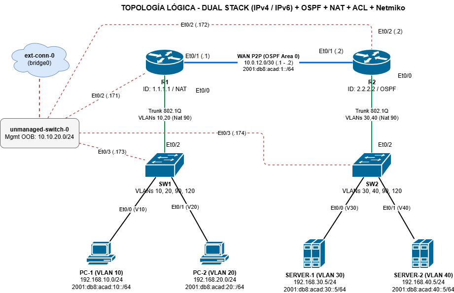

# Topología Lógica: Dual-Stack (IPv4 / IPv6) + OSPF + NAT con Automatización Netmiko

Laboratorio de redes empresariales que integra **enrutamiento Dual-Stack (IPv4 e IPv6)**, **OSPFv2/OSPFv3 (Área 0)**, **segmentación por VLANs con trunking 802.1Q**, **seguridad de Capa 2**, **NAT/PAT** y **automatización con Python y Netmiko** para despliegue de configuraciones e inventario de dispositivos.

## Arquitectura y Topología

### Componentes principales
* **Routers (`R1`, `R2`):**
  * Enlace punto a punto WAN (`10.0.12.0/30` y `2001:db8:acad:1::/64`) con **OSPF Área 0** (`ip ospf network point-to-point` / `ipv6 ospf network point-to-point`).
  * Subinterfaces 802.1Q para VLANs de usuarios y servidores, incluyendo VLAN nativa `90`.
  * **DHCPv4** y **DHCPv6 Stateful** para asignación de direccionamiento.
  * **ACLs extendidas IPv4 e IPv6** en `R1` para controlar el tráfico entre segmentos internos.
  * **NAT/PAT** (pool dinámico con sobrecarga y traducciones estáticas hacia servidores internos) y simulación de enlace externo mediante `Loopback100`.
  * Acceso remoto seguro mediante **SSHv2**.
* **Switches de acceso (`SW1`, `SW2`):**
  * Creación de VLANs (`10`, `20`, `90`, `120` blackhole en `SW1`; `30`, `40`, `90`, `120` blackhole en `SW2`).
  * Puertos de acceso configurados con **Port-Security** (`sticky`, `restrict`), **Spanning Tree PortFast** y **BPDU Guard**, y limitación de tasa en **DHCP Snooping**.
  * Troncales 802.1Q con VLAN nativa `90` y puertos de confianza (`trust`) para DHCP Snooping.
* **Hosts y Servidores (`PC-1`, `PC-2`, `Server-1`, `Server-2`):**
  * Segmentación en VLAN 10 (`192.168.10.0/24` / `2001:db8:acad:10::/64`), VLAN 20 (`192.168.20.0/24` / `2001:db8:acad:20::/64`), VLAN 30 (`192.168.30.0/24` / `2001:db8:acad:30::/64`) y VLAN 40 (`192.168.40.0/24` / `2001:db8:acad:40::/64`).
  * Scripts de apoyo en Linux (`udhcpc` / `udhcpc6` y asignación IPv4/IPv6) documentados en `Configuraciones/Host.txt`.

> **Nota sobre direccionamiento y entorno:** Las configuraciones en `Configuraciones/` y el diagrama en `Topologia/topologia.png` definen la topología lógica Dual-Stack + OSPF + NAT, mientras que `topoly_simple.yaml` y los scripts en `Código_automatización/` incluyen parámetros de red de gestión/sandbox (`10.10.20.0/24`) utilizados durante las pruebas.

## Estructura del Repositorio

Device_Data_automation/

├── README.md
├── topoly_simple.yaml              
├── Topologia/
│   └── topologia.png              
├── Configuraciones/
│   ├── R1.txt                     
│   ├── R2.txt                      
│   ├── Sw1.txt                  
│   ├── Sw2.txt                     
│   └── Host.txt                 
└── Código_automatización/
    ├── device_information.py       
    └── read_file.py             
